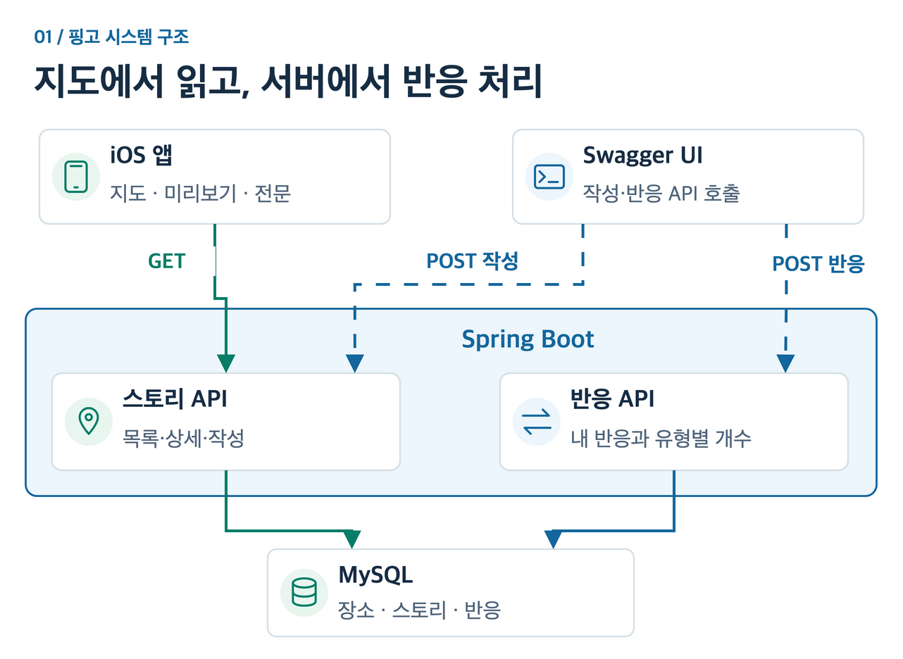
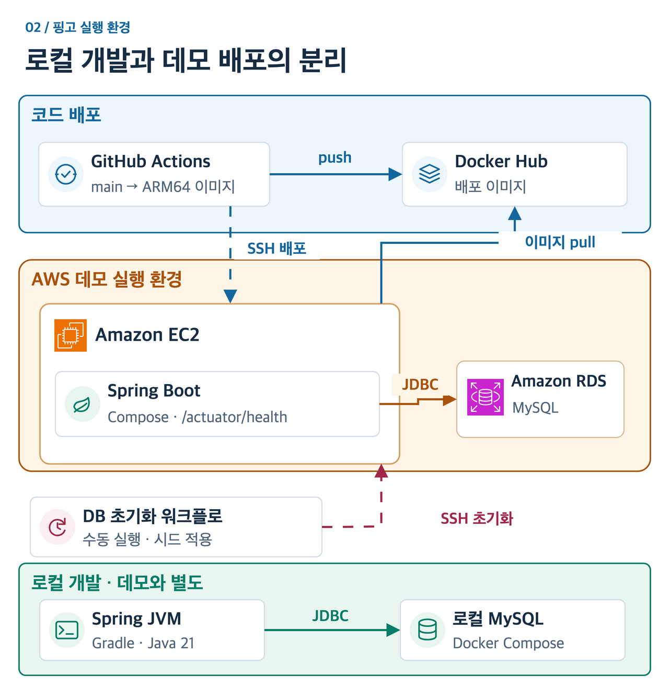
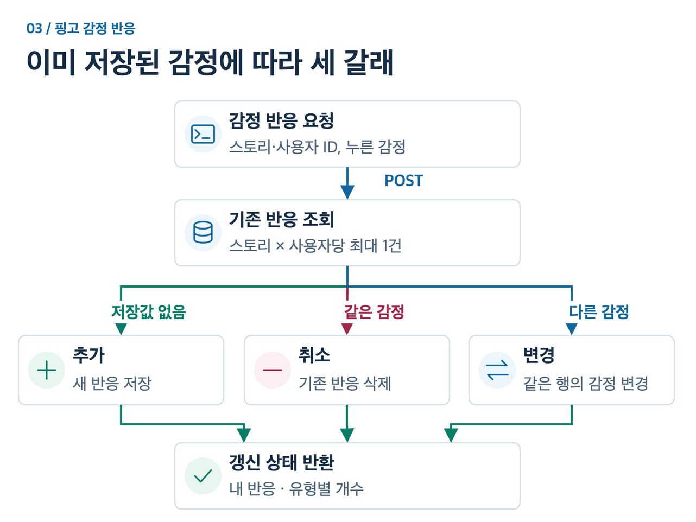

# 핑고 P!NGO!

지도를 둘러보다 장소에 붙은 짧은 경험담을 발견하고, 전문을 읽거나 자기 이야기를 남기는 38기 솝커톤 iOS 2팀 프로젝트입니다. 온라인 피드가 아니라 **장소에서 이야기로 들어가는 흐름**을 만들었습니다.

| 구분 | 내용 |
| --- | --- |
| 형태 | 2026년 5월, 38기 솝커톤 iOS 2팀 |
| 담당 | 서버 공통 기반, 스토리 반응 API, 시연용 데이터 |
| 구성 | Swift·UIKit, Java 21·Spring Boot, MySQL, Docker Compose |
| 저장소 | [서버](https://github.com/SOPT-all/38-SOPKATHON-SERVER-IOS2) · [iOS](https://github.com/SOPT-all/38-SOPKATHON-iOS-iOS2) |

## 문제 정의와 담당 범위

같은 장소에서도 사람마다 기억하는 순간이 다릅니다. 핑고는 지도 위 느낌표와 짧은 미리보기로 이야기를 먼저 발견하게 하고, 궁금한 글의 전문을 열어 읽게 합니다. 긴 댓글을 쓰기 전에 감정으로 반응할 수도 있습니다.

저는 감정 반응을 추가·변경·취소하는 API와 응답 형식을 만들었습니다. 로컬 실행, Swagger와 공통 에러 형태를 정리하고, 팀원들이 같은 게시글과 반응으로 화면을 확인할 수 있게 시연 데이터를 맞췄습니다. 스토리 목록·상세·작성 API는 다른 서버 팀원이, 지도와 아바타·편집 화면은 iOS 팀이 구현했습니다. [반응 PR #7](https://github.com/SOPT-all/38-SOPKATHON-SERVER-IOS2/pull/7) · [스토리 PR #9](https://github.com/SOPT-all/38-SOPKATHON-SERVER-IOS2/pull/9) · [시드 PR #10](https://github.com/SOPT-all/38-SOPKATHON-SERVER-IOS2/pull/10)

## 대표 시연

### 팀 iOS: 지도에서 이야기 전문 열기

https://github.com/user-attachments/assets/6ffa14c2-3be2-4907-9062-4f3438931ca1

지도를 둘러보다 느낌표가 붙은 장소를 누릅니다. 카드에서 이야기 첫 부분을 보고, 더 읽고 싶으면 카드를 열어 제목과 본문을 확인합니다.

### 로컬 API: 감정 반응 추가·전환·취소


Swagger에서 같은 글에 좋아요를 보내면 좋아요가 4개에서 5개가 됩니다. 슬퍼요로 바꾸면 좋아요는 4개, 슬퍼요는 2개가 됩니다. 슬퍼요를 다시 보내면 내 선택이 없어지고 슬퍼요는 1개로 돌아갑니다.

## 주요 기능과 사용자 흐름

지도에서 읽을 글을 고를 때는 짧은 미리보기만 봅니다. 이야기를 남길 때는 작성 화면에서 유형을 고르고 제목과 본문을 입력합니다. 로컬 서버의 작성 API로 글을 등록하면 새 ID가 돌아오고, 그 ID로 본문을 다시 열거나 최신순 목록에서 글을 찾을 수 있습니다.

[iOS 팀 README](https://github.com/SOPT-all/38-SOPKATHON-iOS-iOS2#readme) · [로컬 API 작성 결과](evidence/api-run.jsonl)

## 아키텍처



[시스템 원본](assets/system.drawio)

UIKit 클라이언트가 목록·상세를 HTTP로 읽습니다. 서버는 스토리 조회·작성과 감정 반응을 서로 다른 모듈로 분리하고, 데이터는 MySQL에 저장합니다.



[실행·배포 구성 원본](assets/infra.drawio)

로컬에서는 앱과 DB를 분리해 실행합니다. 배포 구성에는 GitHub Actions의 이미지 빌드, Docker Hub, EC2의 Compose와 RDS 연결 경로가 들어 있습니다.



[반응 처리 원본](assets/reaction.drawio)

## 기술적 의사결정

### 1. 감정 버튼의 세 가지 결과를 서버에서 결정

누르기 전 어떤 감정이 저장됐는지 클라이언트마다 따로 기억하게 하면, 새로고침 뒤 표시와 저장값을 맞춰야 합니다. 저는 반응 버튼이 누른 감정 하나만 보내도록 하고, 서버가 기존 반응을 찾아 **없으면 추가, 같으면 취소, 다르면 전환**하도록 구현했습니다. 스토리와 사용자 조합에 DB 유니크 제약을 두고, 변경 뒤 유형별 수와 내 반응을 함께 반환했습니다. [반응 처리 코드](https://github.com/SOPT-all/38-SOPKATHON-SERVER-IOS2/blob/d4059a3/src/main/java/org/sopt/sopkathon/reaction/application/StoryReactionService.java)

클라이언트는 세 동작을 따로 호출하거나 개수를 자체 계산하지 않아도 됩니다. 대신 같은 요청을 두 번 받으면 선택이 취소될 수 있는 토글입니다. 마지막 의도를 재전송해도 그대로 유지되는 상태 설정 API와는 이 점이 다릅니다.

### 2. 목록에서는 미리보기, 상세에서는 본문과 감정 상태

목록에서 전체 이야기를 모두 읽게 하기보다, 짧은 프리뷰로 고른 이야기를 상세 화면에서 읽는 구조입니다. 팀에서 목록과 상세 응답을 분리했습니다. 목록은 본문 앞 10자까지와 댓글 수, 내 감정을 반환합니다. 상세는 전문, 작성자 표시 이름과 유형별 반응 수까지 반환합니다. 목록의 댓글 수와 내 반응은 목록에 들어갈 스토리 ID들을 모아서 읽습니다. [스토리 조회 코드](https://github.com/SOPT-all/38-SOPKATHON-SERVER-IOS2/blob/d4059a3/src/main/java/org/sopt/sopkathon/story/application/StoryService.java)

### 3. 새 코드 배포와 시연 데이터 초기화를 분리

해커톤에서는 시드가 필요하지만 API를 고칠 때마다 공유 테스트 데이터를 지우면, iOS와 서버가 같은 상태에서 작업하기 어렵습니다. 로컬에서는 스키마와 시드를 재생성할 수 있게 하고, 원격 배포에서는 DB를 보존하는 구성을 두었습니다. 데이터 초기화는 시드 파일을 지정하고 확인 문구를 넣는 별도 수동 워크플로로 뒀습니다. 팀 시연용 시트의 유형과 반응은 서버 enum으로 변환해 동일한 조건을 재현할 수 있도록 했습니다. [해커톤 가이드](https://github.com/SOPT-all/38-SOPKATHON-SERVER-IOS2/blob/d4059a3/docs/HACKATHON_GUIDE.md) · [초기화 워크플로](https://github.com/SOPT-all/38-SOPKATHON-SERVER-IOS2/blob/d4059a3/.github/workflows/reset-db.yml)

## 실행 및 검증

Java 21과 Docker를 준비한 뒤 로컬에서 MySQL과 서버를 실행합니다.

```bash
docker compose -f docker-compose.local.yml up -d mysql
DB_SQL_INIT_DATA_LOCATIONS=classpath:db/seed/pingo.sql ./gradlew bootRun
```

[Swagger](http://localhost:8080/swagger-ui.html)에서 스토리 목록·상세·반응·작성 API를 확인할 수 있습니다. [실행과 검증 기록](evidence/verification.md)
